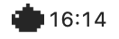
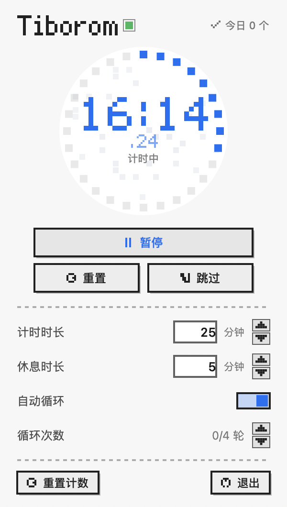
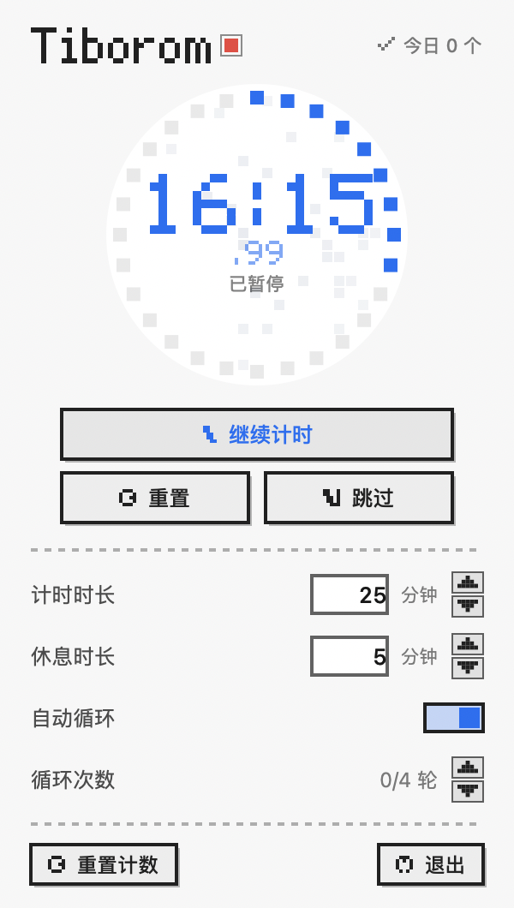
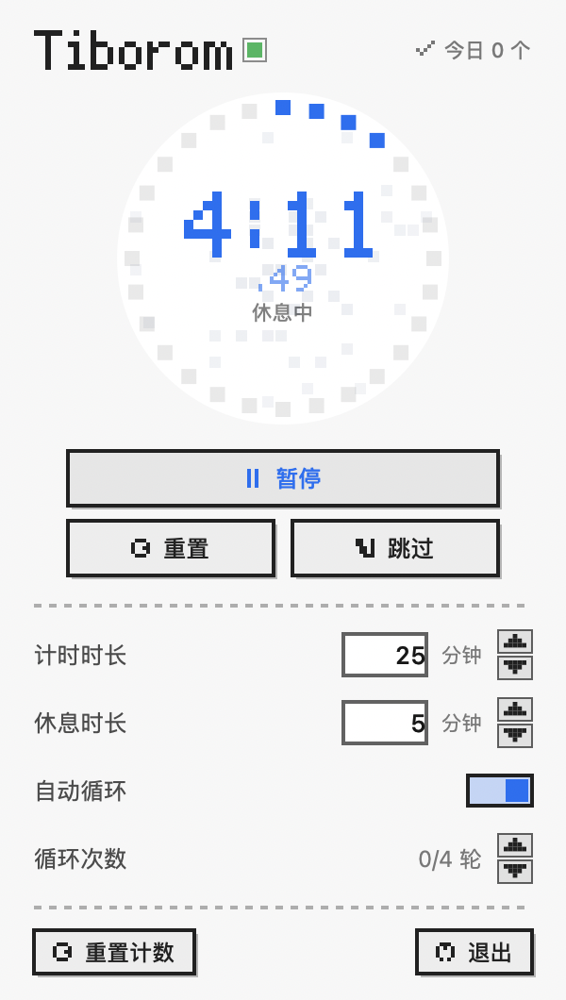
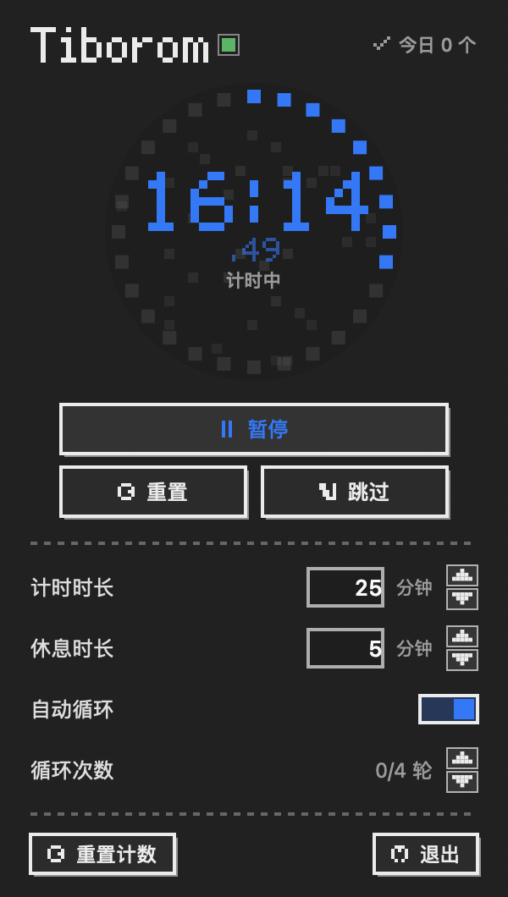

# Tiborom · 像素风 macOS 菜单栏番茄钟

> [Pamodoro](https://github.com/ne0-svg/pamodoro-menubar) 的像素风重制版：**功能、交互、音效完全一致**，
> 视觉全部换成 8-bit 像素语言，配套一枚像素番茄图标。独立项目，不覆盖原版。



| 计时中 | 暂停 | 休息中 | 深色 |
| :---: | :---: | :---: | :---: |
|  |  |  |  |

---

## 和 Pamodoro 的关系

- 功能基线 = Pamodoro v1.3.4：菜单栏倒计时、点开面板、点表盘开始/暂停/继续、
  重置/跳过、任意时长 1–180 分钟、自动循环 + 轮数上限、今日计数（北京时间零点归零）、
  设置持久化、结束提示音与点击音、提示音期间暂停计时。
- 音效文件原样沿用：`Resources/pomo-chime.mp3`、`Resources/click.wav`。
- 性能架构原样沿用 v1.3.4 的修复：面板收起时不向 SwiftUI 发任何事件，
  毫秒位走独立高频通道，整块面板节流发布。
- **隔离**：bundle id `local.maxwell.tiborom`、可执行名 `Tiborom`、环境变量前缀 `TIBOROM_`，
  与 Pamodoro 的设置、进程、调试钩子互不干扰，两个可以同时跑。

## 像素设计

- **点阵字体**：`PixelFont` 内置 5×7 数字/冒号/小数点与 "Tiborom" 字母，
  面板大数字、毫秒位、标题全部用它画方块，不依赖系统字体。
  中文说明文字仍用系统字体（整套 CJK 位图太重，不值当）。
- **进度环**：28 个方块段，点亮段数 = 进度，不画圆弧。
- **表盘背景**：`PixelBackdrop` 粗网格噪点明灭（8fps 硬切换），代替原版的水银液体；
  面板收起时整个从视图树移除。
- **控件**：2px 硬边 + 右下实心投影的像素按钮（按下下移 1px、投影收起）、
  方轨方滑块开关、像素步进器、虚线分隔。
- **菜单栏**：9×9 像素番茄（计时）/ 像素咖啡杯（休息），模板图自动反色；
  时间文字用系统等宽数字保持窄宽度（约 66pt）。
- **App 图标**：16×16 像素番茄，`Scripts/make-icon.swift` 最近邻放大生成全套 icns。

## 实测（M1，计数器差值法）

| 状态 | CPU |
|---|---|
| 面板打开 | **3.4%** |
| 面板关闭（计时中） | **0.7%** |

像素画法全是平面填充，没有渐变/阴影/模糊，比原版的面板渲染更省。

## 从源码构建

环境：macOS 13+、Xcode Command Line Tools（不需要 Xcode 本体）。

```bash
git clone <本仓库>
cd tiborom
./run.sh            # 编译 + 启动，看屏幕右上角菜单栏
```

只编译不启动：

```bash
./build.sh          # 产物 Build/Tiborom.app（universal：arm64 + x86_64）
open Build/Tiborom.app
```

首次打开若被 Gatekeeper 拦（ad-hoc 签名、未公证）：
系统设置 → 隐私与安全性 → 底部「仍要打开」；或
`xattr -dr com.apple.quarantine /path/to/Tiborom.app`。

## 目录结构

```
├── Sources/
│   ├── main.swift            # AppDelegate：状态栏、popover、调试钩子
│   ├── TiboromEngine.swift   # 计时状态机 + 持久化 + 每日归零 + 发布节流
│   ├── PopoverView.swift     # 像素面板 + 像素控件
│   ├── PixelFont.swift       # 5×7 点阵字体与 PixelText
│   ├── PixelBackdrop.swift   # 表盘像素噪点
│   ├── PixelIcon.swift       # 菜单栏像素番茄 / 咖啡杯（模板图）
│   ├── StatusIcon.swift      # 菜单栏图标入口
│   ├── SoundFX.swift         # 点击音
│   └── WatchBeep.swift       # 结束提示音（含合成兜底）
├── Resources/                # 图标 + 两个音效文件
├── Scripts/make-icon.swift   # 像素番茄 → icns
├── Preview/                  # 界面截图
├── build.sh                  # arm64 + x86_64 → lipo → ad-hoc 签名
└── run.sh
```

## 调试

```bash
# 状态栏 item 挂载 / 标题是否在走
TIBOROM_DEBUG=1 TIBOROM_DEBUG_START=1 ./Build/Tiborom.app/Contents/MacOS/Tiborom

# 离屏渲染面板与状态栏截图（不需要屏幕录制权限）
TIBOROM_SNAPSHOT=/tmp/snap TIBOROM_SNAPSHOT_RUNNING=1 ./Build/Tiborom.app/Contents/MacOS/Tiborom
TIBOROM_SNAPSHOT=/tmp/snap TIBOROM_SNAPSHOT_APPEARANCE=dark ./Build/Tiborom.app/Contents/MacOS/Tiborom
```

## 许可证

[MIT](LICENSE) © 2026 ne0-svg
